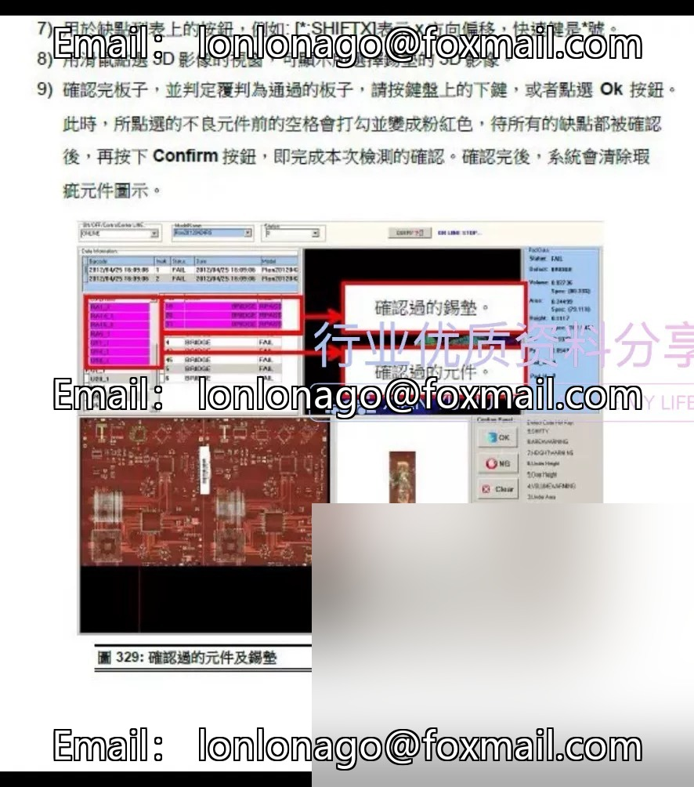
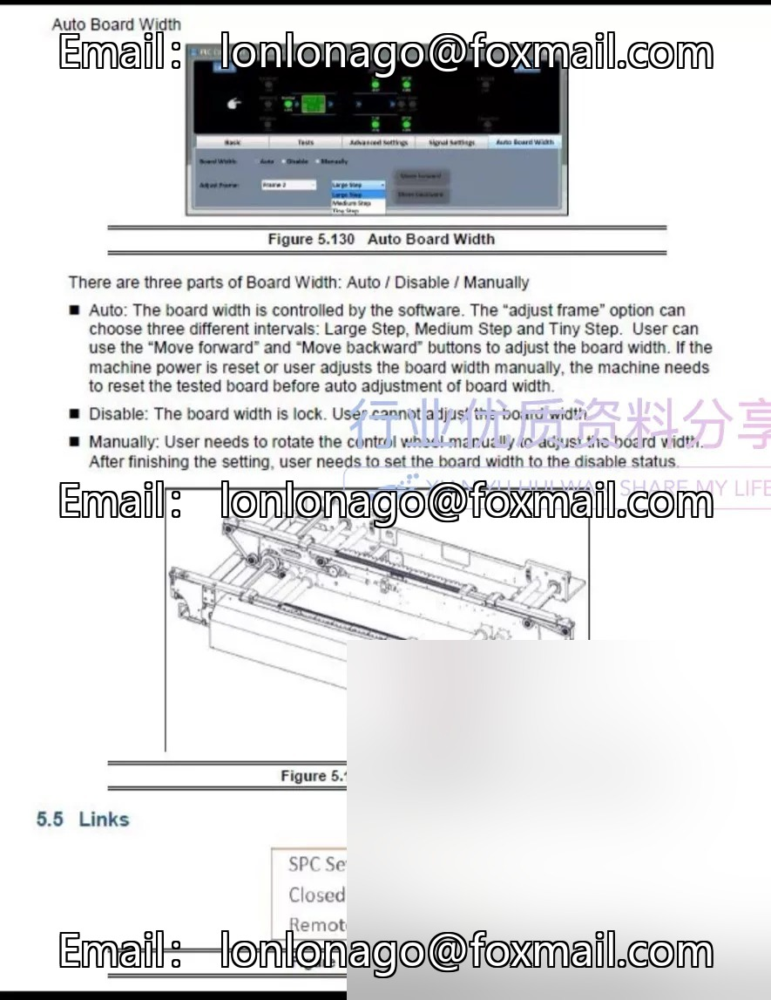
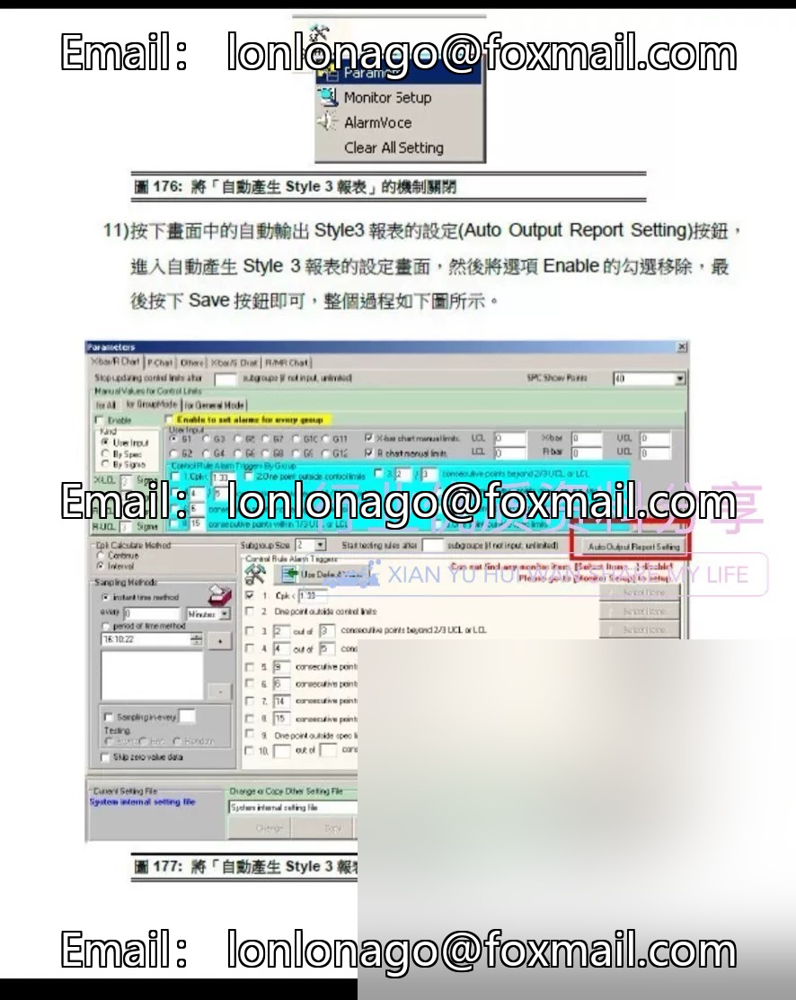
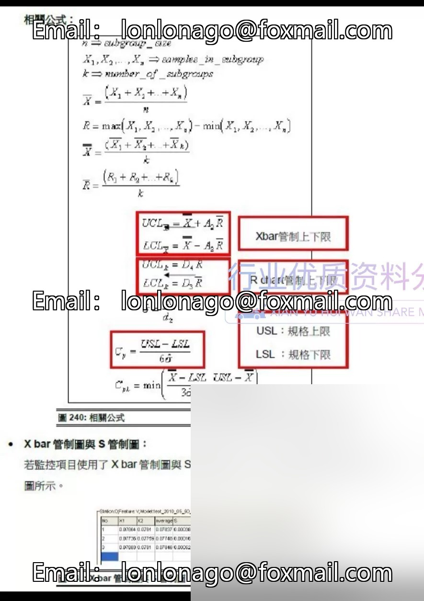
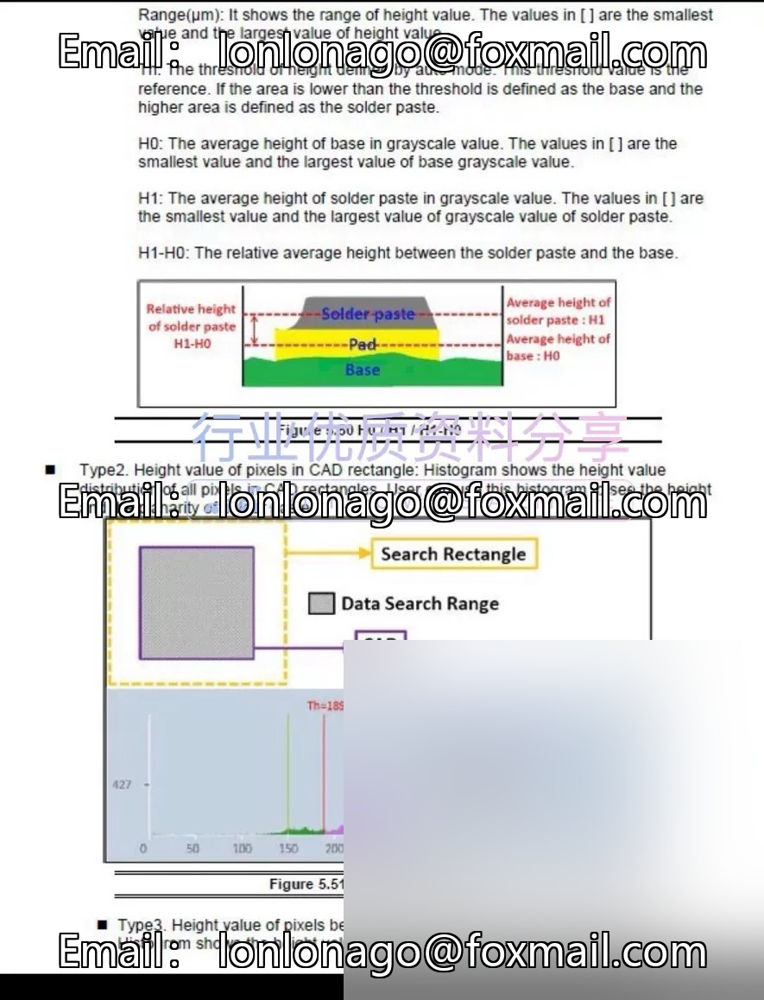

# DRL t-series solder paste printing automatic optical detection machine 7007 SPI user manual (Chinese and English)

## Body

The DLR tin soldering automatic optical inspection machine (SPI user manual, Chinese and English), which contains materials with high reference value such as equipment introduction, inspection principles, operation, usage, maintenance, etc.

Capture and send the electronic original directly! The following images include screenshots of the file portion. Please confirm before placing the order! Due to the replicable nature of electronic documentation Therefore, are allowed after purchase! Thanks for understanding!

For personal learning and reference use only.

The document covers device introduction, detection principles, usage and maintenance, includes an electronic original and states that the file parts in the images must be confirmed before placing the order; the electronic version is copyable and cannot be returned after purchase.

<!-- AI_ENRICHED -->

## Images

## Payment

Here is a pay link on Stripe ( https://buy.stripe.com/3cs8yP7sY87d0vu9AB ). Please contact me lonlonago@foxmail.com after funding $89, and I will send you a complete data files , thank you!

